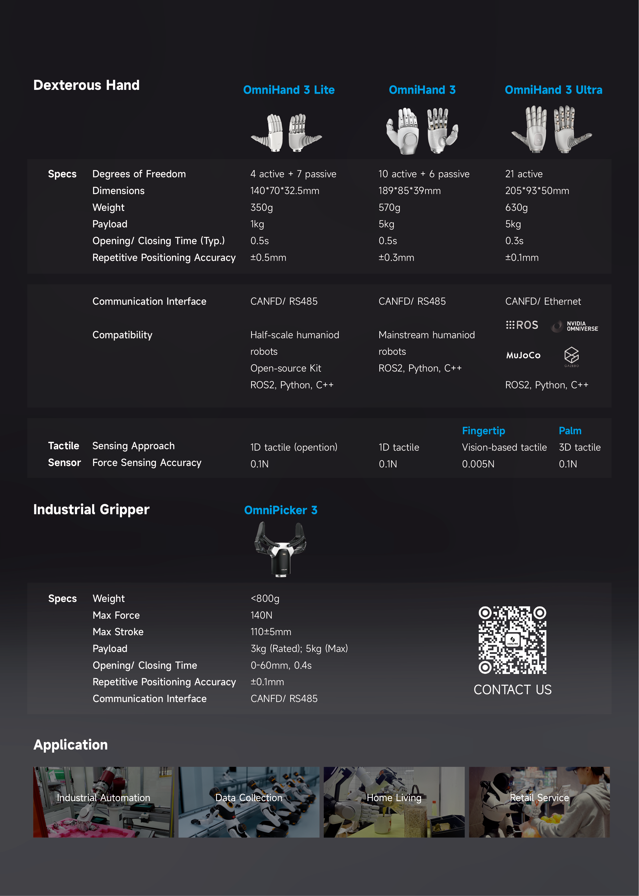

# AGILINK OmniHand SDK

[中文文档](README_zh_cn.md)

## Quick Links

- 📖 **[Quick Start Guide](doc/en/QUICK_START.md)** - Get started in 5 minutes
- 🔧 **[Troubleshooting](doc/en/TROUBLESHOOTING.md)** - Common issues and solutions

## Overview

## Platform-Specific Documentation

- **[Linux (x64/amd64)](linux/x64/README.md)** - Installation, USB setup, ROS2
- **[Linux (arm64/aarch64)](linux/aarch64/README.md)** - Installation, USB setup, ROS2
- **[Windows (x64)](windows/x64/README.md)** - Installation, driver setup

## API Documentation

### C++ API
- [C++ API Index](doc/en/API_CPP.md)
- [OmniHand 2025 (O10) C++ API](doc/en/API_CPP_O10.md)
- [OmniHand Pro 2025 (O12) C++ API](doc/en/API_CPP_O12.md)
- [OmniHand 3 Lite (H3L) C++ API](doc/en/API_CPP_H3L.md)
- [OmniPicker 3 (OP3) C++ API](doc/en/API_CPP_OP3.md)
- [OmniHand Dex UMI (O10 UMI) C++ API](doc/en/API_CPP_O10_UMI.md)
- [OmniHand 3 Ultra M (H3UM T1.3/T1.5) C++ API](doc/en/API_CPP_H3UM.md)

### Python API
- [Python API Index](doc/en/API_PYTHON.md)
- [OmniHand 2025 (O10) Python API](doc/en/API_PYTHON_O10.md)
- [OmniHand Pro 2025 (O12) Python API](doc/en/API_PYTHON_O12.md)
- [OmniHand 3 Lite (H3L) Python API](doc/en/API_PYTHON_H3L.md)
- [OmniHand Dex UMI (O10 UMI) Python API](doc/en/API_PYTHON_UMI.md)
- [OmniHand 3 Ultra M (H3UM T1.3/T1.5) Python API](doc/en/API_PYTHON_H3UM.md)

### Kinematics API
- [OmniHand 2025 (O10) Kinematics C++](doc/en/API_KINEMATICS_CPP_O10.md)
- [OmniHand 2025 (O10) Kinematics Python](doc/en/API_KINEMATICS_PYTHON_O10.md)
- [OmniHand Pro 2025 (O12) Kinematics C++](doc/en/API_KINEMATICS_CPP_O12.md)
- [OmniHand Pro 2025 (O12) Kinematics Python](doc/en/API_KINEMATICS_PYTHON_O12.md)

### ROS2 Interface (Linux Only)
- [ROS2 API Index](doc/en/API_ROS2.md)
- [OmniHand 2025 (O10) ROS2 Interface](doc/en/API_ROS2_O10.md)
- [OmniHand Pro 2025 (O12) ROS2 Interface](doc/en/API_ROS2_O12.md)
- [OmniHand 3 Lite (H3L) ROS2 Interface](doc/en/API_ROS2_H3L.md)
- [OmniHand 3 Ultra M (H3UM T1.3/T1.5) ROS2 Interface](doc/en/API_ROS2_H3UM.md)
- [OmniPicker 3 (OP3) ROS2 Interface](doc/en/API_ROS2_OP3.md)

## License

Mulan PSL v2 - Copyright (c) 2025, Agibot Co., Ltd.
