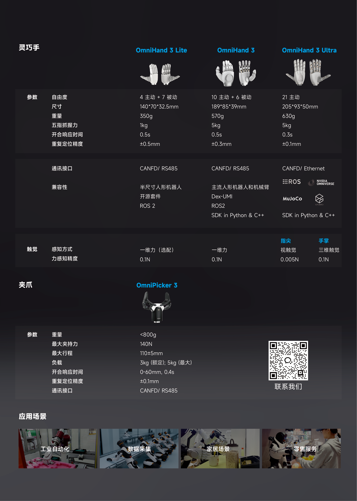

# AGILINK OmniHand SDK

[English Documentation](README.md)

OmniHand SDK 为 OmniHand 系列产品提供 C++、Python 控制接口、运动学求解器及 ROS2 接入。

## 快速链接

- 📖 **[快速入门指南](doc/zh_cn/QUICK_START.md)** - 5 分钟上手
- 🔧 **[故障排除](doc/zh_cn/TROUBLESHOOTING.md)** - 常见问题和解决方案

## 平台文档

- **[Linux (x64/amd64)](linux/x64/README_zh_cn.md)** - 安装、USB 配置、ROS2
- **[Linux (arm64/aarch64)](linux/aarch64/README_zh_cn.md)** - 安装、USB 配置、ROS2
- **[Windows (x64)](windows/x64/README_zh_cn.md)** - 安装、驱动配置

## API 文档

### C++ API

- [C++ API 索引](doc/zh_cn/API_CPP.md)
- [OmniHand 2025 & OmniHand 3 (O10) C++ API](doc/zh_cn/API_CPP_O10.md)
- [OmniHand 2025 & OmniHand 3 (O10) 运动学 C++ API](doc/zh_cn/API_KINEMATICS_CPP_O10.md)（纯计算，与物理连接无关）
- [OmniHand Pro 2025 (O12) C++ API](doc/zh_cn/API_CPP_O12.md)
- [OmniHand Pro 2025 (O12) 运动学 C++ API](doc/zh_cn/API_KINEMATICS_CPP_O12.md)（纯计算，与物理连接无关）
- [OmniHand 3 Lite (H3L) C++ API](doc/zh_cn/API_CPP_H3L.md)
- [OmniHand 3 Lite (H3L) 运动学 C++ API](doc/zh_cn/API_CPP_H3L.md#运动学求解器)（纯计算，与物理连接无关）
- [OmniHandPicker 2025 (OP1) C++ API](doc/zh_cn/API_CPP_OP1.md)
- [OmniPicker 3 (OP3) C++ API](doc/zh_cn/API_CPP_OP3.md)
- [OmniHand 3 Ultra M（H3UM）C++ API](doc/zh_cn/API_CPP_H3UM.md)
- [OmniHand 3 Ultra M（H3UM） 运动学 C++ API](doc/zh_cn/API_CPP_H3UM.md#运动学求解器)（纯计算，与物理连接无关）

### Python API

- [Python API 索引](doc/zh_cn/API_PYTHON.md)
- [OmniHand 2025 & OmniHand 3 (O10) Python API](doc/zh_cn/API_PYTHON_O10.md)
- [OmniHand 2025 & OmniHand 3 (O10) 运动学 Python API](doc/zh_cn/API_KINEMATICS_PYTHON_O10.md)（纯计算，与物理连接无关）
- [OmniHand Pro 2025 (O12) Python API](doc/zh_cn/API_PYTHON_O12.md)
- [OmniHand Pro 2025 (O12) 运动学 Python API](doc/zh_cn/API_KINEMATICS_PYTHON_O12.md)（纯计算，与物理连接无关）
- [OmniHand 3 Lite (H3L) Python API](doc/zh_cn/API_PYTHON_H3L.md)
- [OmniHand 3 Lite (H3L) 运动学 Python API](doc/zh_cn/API_PYTHON_H3L.md#主动关节角与离线求解器)（纯计算，与物理连接无关）
- [OmniPicker 3 (OP3) Python API](doc/zh_cn/API_PYTHON_OP3.md)
- [OmniHand 3 Ultra M（H3UM）Python API](doc/zh_cn/API_PYTHON_H3UM.md)
- [OmniHand 3 Ultra M（H3UM） 运动学 Python API](doc/zh_cn/API_PYTHON_H3UM.md#运动学求解器)（纯计算，与物理连接无关）

### ROS2 接口（仅 Linux）

- [ROS2 API 索引](doc/zh_cn/API_ROS2.md)
- [OmniHand 2025 & OmniHand 3 (O10) ROS2 接口](doc/zh_cn/API_ROS2_O10.md)
- [OmniHand Pro 2025 (O12) ROS2 接口](doc/zh_cn/API_ROS2_O12.md)
- [OmniHand 3 Lite (H3L) ROS2 接口](doc/zh_cn/API_ROS2_H3L.md)
- [OmniHand 3 Ultra M（H3UM）ROS2 接口](doc/zh_cn/API_ROS2_H3UM.md)
- [OmniPicker 3 (OP3) ROS2 接口](doc/zh_cn/API_ROS2_OP3.md)

## 产品介绍

## 许可证

Mulan PSL v2 - Copyright (c) 2025, Agibot Co., Ltd.
