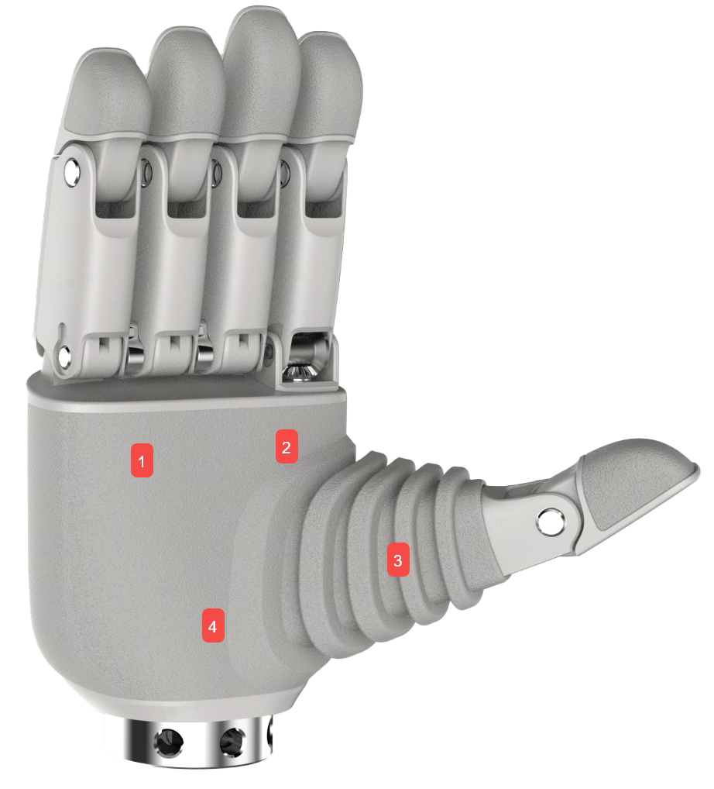

# OmniHand 3 Lite (H3L) C++ API

## Overview

**OmniHand 3 Lite (H3L)** is a 4 DOF lightweight dexterous hand. This document describes the C++ API for controlling and interacting with OmniHand 3 Lite devices.

**Key Features:**
- 4 active degrees of freedom
- Motor position range: 0-4096 (int16 motor ticks)
- Supports CAN (ZLG USB CANFD / HCAN) communication
- Supports SocketCAN (Linux only)
- Supports ZLG CAN TCP (Linux x64 / Windows only)
- **No tactile sensors** on the documented H3L hardware; U16 tactile methods remain as protocol/firmware compatibility APIs
- Supports setting and reading four active joint angles in radians over CAN and RS485. An [offline kinematics solver](#kinematics-solver) also converts between active joint angles and motor positions without a device connection. Full active-plus-passive joint-angle kinematics is not supported.

## Motor Layout



## Include Header

```cpp
#include "omnihand/omnihand_3_lite.h"
#include <cstdint>
using namespace agilink::omnihand;
```

## Enums

### HandType

```cpp
enum class HandType : unsigned char {
    LEFT = 0,      // Left hand
    RIGHT = 1,     // Right hand
    UNKNOWN = 255  // Unknown hand type
};
```

### ControlMode

```cpp
namespace agilink {
namespace omnihand {
enum class ControlMode : unsigned char {
    POSITION                  = 0,    // Position mode (default)
    SERVO                     = 1,    // Servo mode (H3L does not support SetControlMode switching)
    VELOCITY                  = 2,    // Velocity mode (H3L does not support SetControlMode switching)
    TORQUE                    = 3,    // Torque mode (H3L not supported)
    POSITION_TORQUE           = 4,    // Position-Torque mode (Mixed control: position + current)
    VELOCITY_TORQUE           = 5,    // Velocity-Torque mode (H3L not yet available)
    POSITION_VELOCITY_TORQUE  = 6,    // Position-Velocity-Torque mode (Mixed control: position + velocity + current)
    UNKNOWN                   = 10    // Unknown mode
};
}  // namespace omnihand
}  // namespace agilink
```

**H3L control modes and SDK APIs**:
- `POSITION` (0): Default position control
- `POSITION_TORQUE` (4): Position + current mixed control via `MixControlByPT`
- `POSITION_VELOCITY_TORQUE` (6): Position + velocity + current mixed control via `MixControlByPVT`
- See the enum comments above for API restrictions on other modes

## Data Structures

### VendorInfo

```cpp
struct VendorInfo {
    std::string productModel;     // Product model
    std::string productSeqNum;    // Product serial number
    Version hardwareVersion;      // Hardware version
    Version softwareVersion;      // Software version
    int16_t voltage;              // Supply voltage (mV)
    unsigned char dof;            // Degrees of Freedom (4 for H3L)

    std::string toString() const;
};
```

### DeviceInfo

```cpp
struct DeviceInfo {
    unsigned char hand_device_id; // Hand device ID
    CommuParams commu_params;     // Communication parameters
    HandType hand_type;           // Reported hand type
    std::string toString() const;
};
```

## Factory Methods

### Recommended: ZLG USB CANFD (Zero Configuration)

```cpp
/**
 * @brief Factory method - CAN communication (ZLG USB CANFD) by canfd_device_id
 * @param hand_type Hand type (left/right)
 * @param hand_device_id Device ID (default: 1)
 * @param canfd_device_id USB CANFD adapter device index (default: 0)
 * @param canfd_channel_id CAN channel index (default: 0). Dual-channel (200U): can0=0, can1=1; single-channel: always 0
 * @return A unique pointer to OmniHand3Lite instance
 * @note ✅ Recommended: Zero configuration, ready to use out of the box. No root privileges required.
 */
static std::unique_ptr<OmniHand3Lite> createHandByZlgcan(
    HandType hand_type,
    uint8_t hand_device_id = 1,
    uint8_t canfd_device_id = 0,
    uint8_t canfd_channel_id = 0);
```

**Example:**
```cpp
auto hand = OmniHand3Lite::createHandByZlgcan(
    HandType::LEFT,
    1,      // hand_device_id
    0,      // canfd_device_id
    0       // canfd_channel_id
);
```

### Factory Method by Serial Number

```cpp
static std::unique_ptr<OmniHand3Lite> createHandByZlgcan(
    HandType hand_type,
    uint8_t hand_device_id,
    const std::string& usbcanfd_serial_number,
    uint8_t canfd_channel_id = 0);
```

### HCAN USB CANFD

```cpp
static std::unique_ptr<OmniHand3Lite> createHandByHcan(
    HandType hand_type,
    uint8_t hand_device_id,
    uint8_t canfd_device_id,
    uint8_t canfd_channel_id = 0);

static std::unique_ptr<OmniHand3Lite> createHandByHcan(
    HandType hand_type,
    uint8_t hand_device_id,
    const std::string& hcan_serial_number,
    uint8_t canfd_channel_id = 0);
```

### SocketCAN (Linux only)

```cpp
#ifdef __linux__
static std::unique_ptr<OmniHand3Lite> createHandSocketCan(
    HandType hand_type,
    uint8_t hand_device_id,
    const std::string& can_interface = "can0");
#endif
```

### ZLG CAN TCP (partial platform support)

```cpp
#if OMNIHAND_ZLG_TCP_SUPPORTED
static std::unique_ptr<OmniHand3Lite> createHandByZlgCanTcp(
    HandType hand_type,
    uint8_t hand_device_id,
    const std::string& tcp_host,
    uint16_t tcp_port,
    uint8_t canfd_channel_id = 0);
#endif
```

### RS485

```cpp
static std::unique_ptr<OmniHand3Lite> createHandByRs485(
    HandType hand_type,
    uint8_t hand_device_id,
    const std::string& serial_port,
    uint32_t baud_rate = 460800);
```

## Core API

### Initialization

```cpp
bool Init();
```

All factory methods return an instance that requires `Init()` to complete initialization. Returns `false` on failure.

### Gesture Control

```cpp
enum class OmniHand3LiteGesture : int {
  OMNI_HAND_3_LITE_GESTURE_FIST = 1,  // Fist
  OMNI_HAND_3_LITE_GESTURE_OPEN = 2,  // Open hand
};

void SetHandGesture(OmniHand3LiteGesture gesture);
```

Preset gesture positions are defined for the right hand. The solver automatically mirrors motors 1 and 4 for the left hand.

### Motor Position Control

```cpp
int16_t SetJointMotorPosi(unsigned char joint_motor_index, int16_t posi);
std::vector<int16_t> SetAllJointMotorPosi(const std::vector<int16_t>& vec_posi);
int16_t GetJointMotorPosi(unsigned char joint_motor_index) const;
std::vector<int16_t> GetAllJointMotorPosi() const;
```

### Active Joint Angle Control (radians)

```cpp
std::vector<double> SetAllActiveJointAngles(const std::vector<double>& angles);
std::vector<double> GetAllActiveJointAngles() const;
```

Both CAN and RS485 support these methods. Vectors contain four values in radians, ordered by `H3LActivateJoint`. The SDK uses the Solver for the hand object's model and side to convert between angles and motor encoder values; the setter returns active joint angles converted from motor feedback.

> **H3L-S Joint Limit Notice**: The angle limits specified in the SDK and URDF are mechanical limits. Refer to the specification for the corresponding model for motor limit ranges. The table below lists SDK active joint angle ranges in radians (rad); degrees are approximate references. The URDF uses higher-precision decimals.

| Array index (zero-based) | Active joint | SDK angle range (rad) | Approx. degrees |
|---|---|---|---|
| 0 | Coupled middle/ring/little PIP | [0, 1.396263] | 0°–80° |
| 1 | Index PIP | [0, 1.396263] | 0°–80° |
| 2 | Thumb PIP | [0, 1.169370] | 0°–67° |
| 3 | Thumb abduction/adduction | [0, 1.570796] | 0°–90° |

Both hands use the same angle order, positive directions, and ranges; do not negate angles manually. The SDK Solver handles motor encoder direction differences. The motor position range `[0, 4096]` is a protocol range, not the motor limits specified in the product specification.

### Kinematics Solver

`agilink::omnihand::h3l::OmniHand3LiteSolver` provides offline conversion for H3L-S and H3L-M without connecting to a device.

```cpp
#include "omnihand/kinematics/omnihand_3_lite/omnihand_3_lite_solver.h"

using namespace agilink::omnihand::h3l;

OmniHand3LiteSolver solver(true, H3LModel::H3L_S);  // Left H3L-S; use H3L_M for H3L-M.
std::vector<int16_t> motor_positions = {0, 0, 0, 0};
auto angles = solver.ActuatorInput2ActiveJointPos(motor_positions);
auto actuator = solver.ActiveJointPos2ActuatorInput(angles);
```

The one-argument constructor `OmniHand3LiteSolver(is_left_hand)` defaults to H3L-S. Vectors must contain four values in `H3LActivateJoint` order: MRP PIP, index PIP, thumb PIP, thumb abduction/adduction. Angles are radians; motor inputs use `[0, 4096]` protocol units. Vector conversions return an empty vector if the input length is wrong.

Single-joint conversions use a zero-based index (`0..3`):

```cpp
double SingleActuatorInput2ActiveJointPos(std::size_t joint_index, int16_t actuator_input) const;
int16_t SingleActiveJointPos2ActuatorInput(std::size_t joint_index, double rad) const;
```

These Solver methods perform numerical calculations without a device connection. To control a device, call `SetAllActiveJointAngles` and `GetAllActiveJointAngles` directly, or pass offline-converted motor positions to `SetAllJointMotorPosi`. Both `GetAllJointAngles()` and its overload taking active joint angles remain stubs: they return four zeros and do not provide full active-plus-passive joint angles.

### Velocity Control

```cpp
void SetJointMotorVelo(unsigned char joint_motor_index, int16_t velo);     // velo range: 0-32767
int16_t GetJointMotorVelo(unsigned char joint_motor_index) const;
void SetAllJointMotorVelo(const std::vector<int16_t>& vec_velo);          // range: 0-32767
std::vector<int16_t> GetAllJointMotorVelo() const;
```

### Current Threshold Control

> **Note**: O10/H3L: not allowed to both SetCurrentThreshold/SetAllCurrentThreshold and MixControl at the same time.
> If you want to use MixControl, please do not call the current threshold interfaces.

```cpp
void SetCurrentThreshold(unsigned char joint_motor_index, int16_t current_threshold);
int16_t GetCurrentThreshold(unsigned char joint_motor_index) const;
void SetAllCurrentThreshold(const std::vector<int16_t>& current_thresholds);
std::vector<int16_t> GetAllCurrentThreshold() const;
```

### Mixed Control

Supports PT (position + current) and PVT (position + velocity + current) mixed control, with single-axis and batch APIs.

```cpp
MixCtrl MixControlByPT(uint8_t joint_motor_index,
                       int16_t position,
                       int16_t torque);
std::vector<MixCtrl> MixControlByPT(const std::vector<int16_t>& positions,
                                    const std::vector<int16_t>& torques);
MixCtrl MixControlByPVT(uint8_t joint_motor_index,
                        int16_t position,
                        int16_t velocity,
                        int16_t torque);
std::vector<MixCtrl> MixControlByPVT(const std::vector<int16_t>& positions,
                                     const std::vector<int16_t>& velocities,
                                     const std::vector<int16_t>& torques);
```
- `ctrl_mode_`: `MixControlMode::POSITION_TORQUE` (PT) or `MixControlMode::POSITION_VELOCITY_TORQUE` (PVT)
- `tgt_posi_`: target position (0-4095 encoder raw value)
- `tgt_torque_`: target current (unit: mA)

### Error Handling

```cpp
JointMotorErrorReport GetErrorReport(unsigned char joint_motor_index) const;
std::vector<JointMotorErrorReport> GetAllErrorReport() const;
```

### Temperature Monitoring

```cpp
int16_t GetTemperatureReport(unsigned char joint_motor_index) const;
std::vector<int16_t> GetAllTemperatureReport() const;
```

### Current Monitoring

```cpp
int16_t GetCurrentReport(unsigned char joint_motor_index) const;
std::vector<int16_t> GetAllCurrentReport() const;
```

### Vendor & Device Information

```cpp
VendorInfo GetVendorInfo() const;
DeviceInfo GetDeviceInfo() const;
std::string GetSN() const;

uint8_t GetNonPrivateHandDeviceIdByBroadcast();
uint16_t GetPrivateHandDeviceIdByBroadcast();
int GetHandDeviceIdByBroadcast();
bool SetHandDeviceIdByBroadcast(uint8_t id);
```

For H3L, `GetHandDeviceIdByBroadcast()` returns `0` for protocol defaults, a positive custom ID when both protocols agree, and `-1` on failure or mismatch. Passing `0` to `SetHandDeviceIdByBroadcast()` restores the protocol-specific defaults. `SetDeviceId()` remains deprecated compatibility API.

### U16 1D Tactile Sensors

```cpp
size_t GetNumOfTactileSensors() const;
size_t GetNumOfTactilePoints(Finger finger) const;
size_t GetLenOfTactileDatum(Finger finger) const;
size_t GetNumOfRepliedTactileFrames(Finger finger) const;
std::string GetSNOfTactileSensor(Finger finger) const;

TactileSensorDataU16 GetTactileSensorData(Finger finger) const;
TactileSensorDataU16 GetTactileSensorDataRaw(Finger finger) const;
std::vector<TactileSensorDataU16> GetAllTactileSensorDataRaw() const;
```

These methods are exposed for protocol/firmware compatibility. On H3L hardware without tactile sensors they return zero, an empty string, or empty data.

### Debugging

```cpp
void ShowDataDetails(bool show, DataDetailsLogCallback log_callback = nullptr) const;
// When log_callback is set, each line is delivered to the callback; otherwise stdout (see omnihand/utils.h).
```

## Complete Example

```cpp
#include "omnihand/omnihand_3_lite.h"
#include <iostream>

int main() {
    auto hand = OmniHand3Lite::createHandByZlgcan(
        HandType::LEFT, 1, 0, 0);

    if (!hand || !hand->Init()) {
        std::cerr << "Failed to initialize OmniHand 3 Lite" << std::endl;
        return -1;
    }

    auto vendor = hand->GetVendorInfo();
    std::cout << vendor.toString() << std::endl;

    // Set motor positions (4 joints, 0-4095)
    std::vector<int16_t> positions = {2048, 2048, 2048, 2048};
    auto echo = hand->SetAllJointMotorPosi(positions);

    auto temps = hand->GetAllTemperatureReport();
    return 0;
}
```

## Demo Files

| Demo | Path |
|------|------|
| CAN FD (connect by ID) | [H3L_demo_canfd_id.cc](../../../cpp/demo/omnihand_3_lite/H3L_demo_canfd_id.cc) |
| CAN FD (connect by serial) | [H3L_demo_canfd_serial.cc](../../../cpp/demo/omnihand_3_lite/H3L_demo_canfd_serial.cc) |

See [CMakeLists.txt](../../../cpp/demo/omnihand_3_lite/CMakeLists.txt) for build instructions.

## Related Documentation

- [OmniHand 3 Lite (H3L) Python API](API_PYTHON_H3L.md)
- [OmniHand 3 Lite (H3L) ROS2 Interface](API_ROS2_H3L.md)
- [SocketCAN Setup Guide](SOCKETCAN_SETUP.md)
