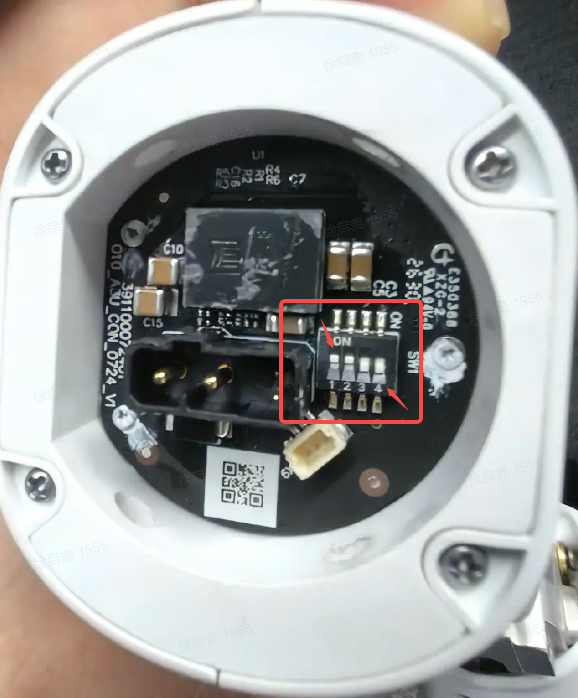

# Quick Start Guide

[中文](../zh_cn/QUICK_START.md)

This guide helps you get started with the OmniHand SDK in 5 minutes.

## Step 1: Hardware Connection

### Supported Products

| Product | Power Supply | ZLG | HCAN | SocketCAN (Linux) | RS485 Serial | USB Direct | DIP Switch |
|---------|--------------|---------------------------|------|-------------------|--------------|------------|---------------------------|
| OmniHand 2025 (O10) | 24V | ✅ | ✅ | ✅ | ✅ | ✅ | ❌ |
| OmniHand 3 (O10) | 24V | ✅ | ✅ | ✅ | ✅ | ❌ | ✅ |
| OmniHand Pro 2025 (O12) | 24V | ✅ | ✅ | ✅ | ❌ | ❌ | ❌ |
| OmniHand 3 Lite (H3L) | 24V | ✅ | ✅ | ✅ | ✅ | ❌ | ✅ |
| OmniHand Dex UMI (O10 UMI) | 24V | ✅ | ✅ | ✅ | ❌ | ❌ | ❌ |
| OmniHand 3 Ultra M (H3UM) | 48V | ✅ | ✅ | ✅ | ❌ | ❌ | ❌ |
| OmniHandPicker 2025 (OP1) | 24V | ✅ | ✅ | ✅ | ❌ | ✅ | ❌ |
| OmniPicker 3 (OP3) | 24V | ✅ | ✅ | ✅ | ✅ | ❌ | ✅ |

The “DIP Switch” column indicates whether the product has a physical switch for selecting CANFD or RS485. See the wiring instructions below for switch positions.

### CANFD Adapters and Setup

| Connection | Supported Models | Setup |
|------------|------------------|-------|
| ZLG USBCANFD (recommended) | 100U-mini, 100U, 200U | — |
| HCAN | CANFD-I, CANFD-II | — |
| SocketCAN (Linux) | Any CAN adapter with a SocketCAN driver | [SocketCAN Setup](SOCKETCAN_SETUP.md) |

### Recommended: ZLG USBCANFD Adapter (All Products)

1. Connect your computer to the **USB port on the CAN adapter (ZLG USBCANFD)**. Use one of the adapter models listed above; other CAN adapters are unlikely to work with the SDK directly.
2. For products with an **interface selector DIP switch** (see the product table), set the switches according to the orientation in the photo: **CANFD: 1 and 2 up, 3 and 4 down; RS485: 1 and 2 down, 3 and 4 up.**

   

3. Connect the CAN adapter to your OmniHand using the CANFD cable, matching **CAN_H to CAN_H and CAN_L to CAN_L**. If CAN_H and CAN_L are reversed, the hand will not respond.
4. Power on the OmniHand using the voltage listed in the product table. Its indicator light will turn on after power is applied.

```
[Computer] --USB--> [ZLG USBCANFD] --CANFD--> [OmniHand]
                                          |
                                    [Power Supply]
```

## Step 2: Install SDK

### Requirements

| | Linux | Windows |
|---|-------|---------|
| **OS** | Ubuntu 22.04+ | Windows 10/11 |
| **Python** | 3.10+ | 3.10+ |
| **C++ Compiler** | gcc 11.4+ | MSVC 2019+ |
| **C++ Standard** | C++17+ | C++17+ |
| **CMake** | 3.22+ | 3.22+ |
| **ROS2** (optional) | Humble/Jazz | ❌ Not supported |

### Linux

```bash
cd linux/x64
./install.sh

# Configure USB permissions (first time only, required for both CANFD adapters and RS485 serial ports)
sudo ./setup_udev.sh
# Then log out and log back in
```

### Windows

Run as Administrator:
```cmd
cd windows\x64
install.bat
```

## Step 3: Verify with the Product Test Suite

Connect and power on the device, close other CAN tools, and leave room for test movements.

### Select Your Product

Test files are located under the SDK release package's platform directory (`linux/x64`, `linux/aarch64`, or `windows/x64`):

| Contents | Relative Path |
|----------|---------------|
| Python test scripts | `python/test/` |
| C++ test executables | `cpp/bin/omnihand/test/` |
| C++ test source files | `cpp/test/` |

Choose the file for your product from the corresponding directory:

| Product | C++ test executable | Python test file |
|---------|---------------------|------------------|
| OmniHand 2025 & OmniHand 3 (O10) | `test_omnihand_2025` | `test_omnihand_2025.py` |
| OmniHand 3 Lite (H3L) | `test_omnihand_3_lite` | `test_omnihand_3_lite.py` |
| OmniPicker 3 (OP3) | `test_omnipicker_3` | `test_omnipicker_3.py` |
| OmniHand Pro 2025 (O12) | `test_omnihand_pro_2025` | `test_omnihand_pro_2025.py` |

The following examples use **O10** to demonstrate testing with different connection types. Run the commands from the platform directory listed above.

### C++ (gtest)

Use the prebuilt test executables included in the release package.

**Linux:**

```bash
# ZLG CANFD
./cpp/bin/omnihand/test/test_omnihand_2025 -d zlgcan
# HCAN
./cpp/bin/omnihand/test/test_omnihand_2025 -d hcan
# Optional: O10 device ID change test
./cpp/bin/omnihand/test/test_omnihand_2025 -d zlgcan --device-id 5
# Connection options
./cpp/bin/omnihand/test/test_omnihand_2025 -h
```

**Windows (PowerShell; reopen the terminal after installation so the SDK DLL path takes effect):**

```powershell
# ZLG CANFD
.\cpp\bin\omnihand\test\test_omnihand_2025.exe -d zlgcan
# HCAN
.\cpp\bin\omnihand\test\test_omnihand_2025.exe -d hcan
# Optional: O10 device ID change test
.\cpp\bin\omnihand\test\test_omnihand_2025.exe -d zlgcan --device-id 5
# Connection options
.\cpp\bin\omnihand\test\test_omnihand_2025.exe --help
```

### Python (pytest)

Use the Python environment in which the SDK was installed. The O10 test script invokes pytest internally and accepts connection arguments directly.

**Linux:**

```bash
python3 -m pip install pytest
python3 python/test/test_omnihand_2025.py -d zlgcan
```

**Windows (PowerShell):**

```powershell
python -m pip install pytest
python .\python\test\test_omnihand_2025.py -d zlgcan
```

**O10 connection arguments:**

| Argument | Meaning |
|----------|---------|
| `-d` | Transport: `zlgcan`, `hcan`, `socketcan`, `zlgcantcp`, `usb`, or `rs485` |
| `-p` | Serial port for `usb` or `rs485`; use the port assigned to your device |
| `-i` | CANFD adapter index, starting at 0 |
| `-c` | CAN channel index, starting at 0 |
| `--device-id` | Target ID for O10 ID-change testing (1–127); cleanup restores the original ID. Omit to discover the current ID only. |

Choose the command matching your connection:

**Linux:**

```bash
# HCAN
python3 python/test/test_omnihand_2025.py -d hcan
# RS485
python3 python/test/test_omnihand_2025.py -d rs485 -p /dev/ttyUSB0
# USB direct (OmniHand 2025)
python3 python/test/test_omnihand_2025.py -d usb -p /dev/ttyACM0
# Optional: O10 device ID change test
python3 python/test/test_omnihand_2025.py -d zlgcan --device-id 5
# pytest help
python3 python/test/test_omnihand_2025.py -h
```

**Windows (PowerShell):**

```powershell
# HCAN
python .\python\test\test_omnihand_2025.py -d hcan
# RS485
python .\python\test\test_omnihand_2025.py -d rs485 -p COM5
# USB direct (OmniHand 2025)
python .\python\test\test_omnihand_2025.py -d usb -p COM3
# Optional: O10 device ID change test
python .\python\test\test_omnihand_2025.py -d zlgcan --device-id 5
# pytest help
python .\python\test\test_omnihand_2025.py --help
```

### Check the Results

- gtest reports the executed test count and `[ PASSED ]`, `[ FAILED ]`, or `[ SKIPPED ]` results.
- pytest reports each case and a final `passed / failed / skipped` summary; `-s` also displays device information and feedback.
- Confirm that initialization, device information, and the expected feedback tests pass. Zero executed tests or an entirely skipped suite does not verify the connection. Investigate failures or skipped cases before treating verification as complete; see [Troubleshooting](TROUBLESHOOTING.md).

## Step 4: First Program

### C++ Example

O10 left hand, ZLG adapter 0, channel 0: discover device IDs, read motor positions, then send the measured positions as the target. Positions use motor encoder values.

Create a `my_omnihand_app` directory containing these two files:

**CMakeLists.txt:**

```cmake
cmake_minimum_required(VERSION 3.22)
project(my_omnihand_app LANGUAGES CXX)

if(WIN32)
  list(APPEND CMAKE_MODULE_PATH "C:/omnihand/share/cmake/omnihand")
else()
  list(APPEND CMAKE_MODULE_PATH "/usr/local/share/cmake/omnihand")
endif()
find_package(omnihand REQUIRED)

add_executable(my_app main.cpp)
target_compile_features(my_app PRIVATE cxx_std_17)
target_link_libraries(my_app PRIVATE omnihand)
```

**main.cpp:**

```cpp
#include <iostream>
#include "omnihand/omnihand_2025.h"

using namespace agilink::omnihand;

int main() {
  // Default protocol IDs, adapter 0, channel 0.
  auto hand = OmniHand2025::createHandByZlgcan(HandType::LEFT, 0, 0, 0);
  if (!hand || !hand->Init()) {
    std::cerr << "Failed to initialize CAN adapter\n";
    return 1;
  }
  if (hand->GetHandDeviceIdByBroadcast() < 0) {
    std::cerr << "Device ID discovery failed\n";
    return 1;
  }

  const auto positions = hand->GetAllJointMotorPosi();
  if (positions.size() != OmniHand2025::kDegreesOfActiveFreedom) {
    std::cerr << "Failed to read motor positions\n";
    return 1;
  }
  std::cout << "Motor positions: ";
  for (const auto position : positions) {
    std::cout << position << ' ';
  }
  std::cout << '\n';

  // Hold the measured motor positions.
  const auto feedback = hand->SetAllJointMotorPosi(positions);
  if (feedback.size() != positions.size()) {
    std::cerr << "No valid control feedback\n";
    return 1;
  }
  std::cout << "Position command sent\n";
  return 0;
}
```

Build and run from `my_omnihand_app` after installing the SDK:

**Linux:**

```bash
cmake -S . -B build
cmake --build build
./build/my_app
```

**Windows (PowerShell, MSVC x64):**

```powershell
cmake -S . -B build -A x64
cmake --build build --config Release
.\build\Release\my_app.exe
```

API reference: [O10 C++ API](API_CPP_O10.md).

### Python Example

Save as `my_app.py`; it follows the same connection and control flow as the C++ example.

```python
from omnihand import HandType, OmniHand2025

hand = OmniHand2025.create_hand_by_zlgcan(
    hand_type=HandType.LEFT,
    hand_device_id=0,  # Use protocol defaults before explicit discovery.
    canfd_device_id=0,
    canfd_channel_id=0,
)
if hand is None or not hand.init():
    raise SystemExit("Failed to initialize CAN adapter")
if hand.get_hand_device_id_by_broadcast() < 0:
    raise SystemExit("Device ID discovery failed")

positions = hand.get_all_joint_positions()
if len(positions) != OmniHand2025.kDegreesOfActiveFreedom:
    raise SystemExit("Failed to read motor positions")
print(f"Motor positions: {positions}")

# Hold the measured motor positions.
feedback = hand.set_all_joint_positions(positions)
if len(feedback) != len(positions):
    raise SystemExit("No valid control feedback")
print("Position command sent")
```

**Linux:**

```bash
python3 my_app.py
```

**Windows (PowerShell):**

```powershell
python .\my_app.py
```

API reference: [O10 Python API](API_PYTHON_O10.md).

### ROS2 Example (Linux Only)

```bash
# Source ROS2 and OmniHand
source ros2/setup.bash

# Launch node using launch file (recommended, defaults to single left hand)
ros2 launch omnihand_node omnihand_2025_node.launch.py

# Or use ros2 run (uses default parameters)
ros2 run omnihand_node omnihand_2025_node
```

**Control via ROS2 Topics:**

```bash
# Set joint positions (10 values, using sensor_msgs/JointState)
ros2 topic pub /o10/left/joint_cmd sensor_msgs/msg/JointState \
  "{position: [0.0, 0.0, 0.0, 0.0, 0.0, 0.0, 0.0, 0.0, 0.0, 0.0]}"

# Read joint states
ros2 topic echo /o10/left/joint_states

# Request current data (trigger-based readback)
ros2 topic pub /o10/left/joint_current_cmd std_msgs/msg/Empty "{}"
ros2 topic echo /o10/left/joint_current_states
```

> See [ROS2 API Documentation](API_ROS2.md) for the full topic list and product-specific differences.

## Step 5: Explore Demos

Paths below are relative to the release package's platform directory (`linux/x64`, `linux/aarch64`, or `windows/x64`).

### C++

| Product | Path |
|---------|------|
| OmniHand 2025 & OmniHand 3 (O10) | `cpp/demo/omnihand_2025/` |
| OmniHand Pro 2025 (O12) | `cpp/demo/omnihand_pro_2025/` |
| OmniHand 3 Lite (H3L) | `cpp/demo/omnihand_3_lite/` |
| OmniHand Dex UMI (O10 UMI) | `cpp/demo/omnihand_dex_umi/` |
| OmniHand 3 Ultra M (H3UM) | `cpp/demo/omnihand_3_ultra_m/` |
| OmniHandPicker 2025 (OP1) | `cpp/demo/omnipicker_2025/` |
| OmniPicker 3 (OP3) | `cpp/demo/omnipicker_3/` |

### Python

| Product | Path |
|---------|------|
| OmniHand 2025 & OmniHand 3 (O10) | `python/demo/omnihand_2025/` |
| OmniHand Pro 2025 (O12) | `python/demo/omnihand_pro_2025/` |
| OmniHand 3 Lite (H3L) | `python/demo/omnihand_3_lite/` |
| OmniHand Dex UMI (O10 UMI) | `python/demo/omnihand_dex_umi/` |

### ROS2 (Linux Only)

`<distro>` is `humble` or `jazzy`, matching your ROS2 environment.

| Type | Product | Path |
|------|---------|------|
| scripts | OmniHand 2025 & OmniHand 3 (O10) | `ros2/<distro>/lib/omnihand_node/scripts/omnihand_2025/` |
| scripts | OmniHand Pro 2025 (O12) | `ros2/<distro>/lib/omnihand_node/scripts/omnihand_pro_2025/` |
| scripts | OmniHand 3 Lite (H3L) | `ros2/<distro>/lib/omnihand_node/scripts/omnihand_3_lite/` |
| scripts | OmniHand 3 Ultra M (H3UM) | `ros2/<distro>/lib/omnihand_node/scripts/omnihand_3_ultra_m/` |
| scripts | OmniPicker 3 (OP3) | `ros2/<distro>/lib/omnihand_node/scripts/omnipicker_3/` |
| demo | Shared C++ examples | `ros2/<distro>/share/omnihand_node/demo/` |

## Next Steps

### API Reference

1. **OmniHand 2025 & OmniHand 3 (O10)**

   - [O10 C++ API](API_CPP_O10.md)
   - [O10 Python API](API_PYTHON_O10.md)
   - [O10 ROS2 API](API_ROS2_O10.md) (ROS2: Linux only)
   - [O10 Kinematics C++ API](API_KINEMATICS_CPP_O10.md) (pure computation, independent of physical connections)
   - [O10 Kinematics Python API](API_KINEMATICS_PYTHON_O10.md) (pure computation, independent of physical connections)

2. **OmniHand Pro 2025 (O12)**

   - [O12 C++ API](API_CPP_O12.md)
   - [O12 Python API](API_PYTHON_O12.md)
   - [O12 ROS2 API](API_ROS2_O12.md) (ROS2: Linux only)
   - [O12 Kinematics C++ API](API_KINEMATICS_CPP_O12.md) (pure computation, independent of physical connections)
   - [O12 Kinematics Python API](API_KINEMATICS_PYTHON_O12.md) (pure computation, independent of physical connections)

3. **OmniHand 3 Lite (H3L)**

   - [H3L C++ API](API_CPP_H3L.md)
   - [H3L Python API](API_PYTHON_H3L.md)
   - [H3L ROS2 API](API_ROS2_H3L.md) (ROS2: Linux only)
   - [H3L Kinematics C++ API](API_CPP_H3L.md#kinematics-solver) (pure computation, independent of physical connections)
   - [H3L Kinematics Python API](API_PYTHON_H3L.md#active-joint-angles-and-offline-solver) (pure computation, independent of physical connections)

4. **OmniHand Dex UMI (O10 UMI)**

   - [O10 UMI C++ API](API_CPP_O10_UMI.md)
   - [O10 UMI Python API](API_PYTHON_UMI.md)

5. **OmniHand 3 Ultra M (H3UM)**

   - [H3UM C++ API](API_CPP_H3UM.md)
   - [H3UM Python API](API_PYTHON_H3UM.md)
   - [H3UM ROS2 API](API_ROS2_H3UM.md) (ROS2: Linux only)
   - [H3UM Kinematics C++ API](API_CPP_H3UM.md#kinematics-solver) (pure computation, independent of physical connections)
   - [H3UM Kinematics Python API](API_PYTHON_H3UM.md#kinematics-solver) (pure computation, independent of physical connections)

6. **OmniHandPicker 2025 (OP1)**

   - [OP1 C++ API](API_CPP_OP1.md)

7. **OmniPicker 3 (OP3)**

   - [OP3 C++ API](API_CPP_OP3.md)
   - [OP3 Python API](API_PYTHON_OP3.md)
   - [OP3 ROS2 API](API_ROS2_OP3.md) (ROS2: Linux only)

**[Troubleshooting](TROUBLESHOOTING.md)** - Common issues and solutions
