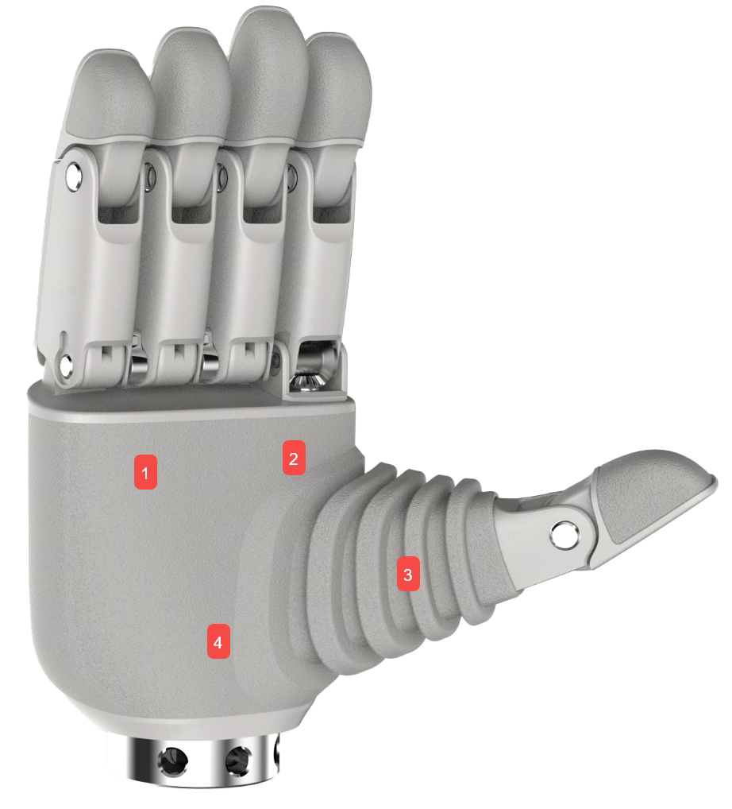

# OmniHand 3 Lite (H3L) C++ API

## 概述

**OmniHand 3 Lite (H3L)** 是一款 4 自由度轻量级灵巧手。本文档描述了用于控制和交互 OmniHand 3 Lite 设备的 C++ API。

**主要特性：**
- 4 个主动自由度
- 电机位置范围：0–4096（int16 电机 ticks）
- 支持 CAN（ZLG USB CANFD / HCAN）通信
- 支持 SocketCAN（仅 Linux）
- 支持 ZLG CAN TCP（仅 Linux x64 / Windows）
- 文档所述 H3L 硬件**无触觉传感器**；U16 触觉方法作为协议/固件兼容接口保留
- 支持通过 CAN 和 RS485 直接设置、读取 4 个主动关节角（单位：弧度）；[离线运动学求解器](#运动学求解器)也可独立完成主动关节角与电机位置换算。尚不支持完整的主动加被动关节角运动学。

## 电机分布



## 包含头文件

```cpp
#include "omnihand/omnihand_3_lite.h"
#include <cstdint>
using namespace agilink::omnihand;
```

## 枚举类型

### HandType

```cpp
enum class HandType : unsigned char {
    LEFT = 0,      // 左手
    RIGHT = 1,     // 右手
    UNKNOWN = 255  // 未知手型
};
```

### ControlMode

```cpp
namespace agilink {
namespace omnihand {
enum class ControlMode : unsigned char {
    POSITION                  = 0,    // 位置模式（默认）
    SERVO                     = 1,    // 伺服模式（H3L 不支持 SetControlMode 切换）
    VELOCITY                  = 2,    // 速度模式（H3L 不支持 SetControlMode 切换）
    TORQUE                    = 3,    // 力控模式（H3L 不支持）
    POSITION_TORQUE           = 4,    // 位置-力控模式（混合控制：位置 + 电流）
    VELOCITY_TORQUE           = 5,    // 速度-力控模式（H3L 暂未开放）
    POSITION_VELOCITY_TORQUE  = 6,    // 位置-速度-力控模式（混合控制：位置 + 速度 + 电流）
    UNKNOWN                   = 10    // 未知模式
};
}  // namespace omnihand
}  // namespace agilink
```

**H3L 控制模式与 SDK 接口**：
- `POSITION` (0)：默认位置控制
- `POSITION_TORQUE` (4)：位置+电流混合控制，使用 `MixControlByPT`
- `POSITION_VELOCITY_TORQUE` (6)：位置+速度+电流混合控制，使用 `MixControlByPVT`
- 其他模式的接口限制参见上述枚举说明

## 数据结构

### VendorInfo

```cpp
struct VendorInfo {
    std::string productModel;     // 产品型号
    std::string productSeqNum;    // 产品序列号
    Version hardwareVersion;      // 硬件版本
    Version softwareVersion;      // 软件版本
    int16_t voltage;              // 供电电压 (mV)
    unsigned char dof;            // 自由度（H3L 为 4）

    std::string toString() const;
};
```

### DeviceInfo

```cpp
struct DeviceInfo {
    unsigned char hand_device_id; // 手部设备 ID
    CommuParams commu_params;     // 通信参数
    HandType hand_type;           // 设备上报的手型
    std::string toString() const;
};
```

## 工厂方法

### 推荐：ZLG USB CANFD（零配置）

```cpp
/**
 * @brief 工厂方法 - CAN 通信（ZLG USB CANFD），通过 canfd_device_id
 * @param hand_type 手型（左/右手）
 * @param hand_device_id 设备 ID（默认：1）
 * @param canfd_device_id USB CANFD 适配器设备索引（默认：0）
 * @param canfd_channel_id CAN 通道索引（默认：0）。双通道（200U）：can0=0, can1=1；单通道：始终为 0
 * @return OmniHand3Lite 实例的唯一指针
 * @note 推荐：零配置，开箱即用。无需 root 权限。
 */
static std::unique_ptr<OmniHand3Lite> createHandByZlgcan(
    HandType hand_type,
    uint8_t hand_device_id = 1,
    uint8_t canfd_device_id = 0,
    uint8_t canfd_channel_id = 0);
```

**示例：**
```cpp
auto hand = OmniHand3Lite::createHandByZlgcan(
    HandType::LEFT,
    1,      // hand_device_id
    0,      // canfd_device_id
    0       // canfd_channel_id
);
```

### 通过序列号创建

```cpp
static std::unique_ptr<OmniHand3Lite> createHandByZlgcan(
    HandType hand_type,
    uint8_t hand_device_id,
    const std::string& usbcanfd_serial_number,
    uint8_t canfd_channel_id = 0);
```

### HCAN USB CANFD

```cpp
static std::unique_ptr<OmniHand3Lite> createHandByHcan(
    HandType hand_type,
    uint8_t hand_device_id,
    uint8_t canfd_device_id,
    uint8_t canfd_channel_id = 0);

static std::unique_ptr<OmniHand3Lite> createHandByHcan(
    HandType hand_type,
    uint8_t hand_device_id,
    const std::string& hcan_serial_number,
    uint8_t canfd_channel_id = 0);
```

### SocketCAN（仅 Linux）

```cpp
#ifdef __linux__
static std::unique_ptr<OmniHand3Lite> createHandSocketCan(
    HandType hand_type,
    uint8_t hand_device_id,
    const std::string& can_interface = "can0");
#endif
```

### ZLG CAN TCP（仅部分平台）

```cpp
#if OMNIHAND_ZLG_TCP_SUPPORTED
static std::unique_ptr<OmniHand3Lite> createHandByZlgCanTcp(
    HandType hand_type,
    uint8_t hand_device_id,
    const std::string& tcp_host,
    uint16_t tcp_port,
    uint8_t canfd_channel_id = 0);
#endif
```

### RS485

```cpp
static std::unique_ptr<OmniHand3Lite> createHandByRs485(
    HandType hand_type,
    uint8_t hand_device_id,
    const std::string& serial_port,
    uint32_t baud_rate = 460800);
```

## 主要接口

### 初始化

```cpp
bool Init();
```

所有工厂方法返回的实例在创建后需调用 `Init()` 完成初始化。`Init()` 失败时返回 `false`。

### 手势控制

```cpp
enum class OmniHand3LiteGesture : int {
  OMNI_HAND_3_LITE_GESTURE_FIST = 1,  // 握拳
  OMNI_HAND_3_LITE_GESTURE_OPEN = 2,  // 张开
};

void SetHandGesture(OmniHand3LiteGesture gesture);
```

预设手势位置以右手为基准，左手时求解器自动镜像电机 1 和电机 4。

### 电机位置控制

```cpp
int16_t SetJointMotorPosi(unsigned char joint_motor_index, int16_t posi);
std::vector<int16_t> SetAllJointMotorPosi(const std::vector<int16_t>& vec_posi);
int16_t GetJointMotorPosi(unsigned char joint_motor_index) const;
std::vector<int16_t> GetAllJointMotorPosi() const;
```

### 主动关节角度控制（弧度）

```cpp
std::vector<double> SetAllActiveJointAngles(const std::vector<double>& angles);
std::vector<double> GetAllActiveJointAngles() const;
```

CAN 和 RS485 均支持上述接口。向量包含 4 个值，单位为弧度（rad），顺序与 `H3LActivateJoint` 一致。SDK 使用手对象对应型号及左右手的 Solver 完成角度与电机编码换算；设置接口返回电机反馈换算后的主动关节角。

### 运动学求解器

`agilink::omnihand::h3l::OmniHand3LiteSolver` 提供 H3L-S 和 H3L-M 的离线换算，无需连接设备。

```cpp
#include "omnihand/kinematics/omnihand_3_lite/omnihand_3_lite_solver.h"

using namespace agilink::omnihand::h3l;

OmniHand3LiteSolver solver(true, H3LModel::H3L_S);  // Left H3L-S; use H3L_M for H3L-M.
std::vector<int16_t> motor_positions = {0, 0, 0, 0};
auto angles = solver.ActuatorInput2ActiveJointPos(motor_positions);
auto actuator = solver.ActiveJointPos2ActuatorInput(angles);
```

单参数构造 `OmniHand3LiteSolver(is_left_hand)` 默认使用 H3L-S。向量必须包含 4 个值，按 `H3LActivateJoint` 顺序排列：中指/无名指/小指联动 PIP、食指 PIP、拇指 PIP、拇指外展/内收。角度单位为弧度，电机输入使用 `[0, 4096]` 协议值。向量长度不正确时，换算返回空向量。

单关节换算使用从 0 开始的索引（`0..3`）：

```cpp
double SingleActuatorInput2ActiveJointPos(std::size_t joint_index, int16_t actuator_input) const;
int16_t SingleActiveJointPos2ActuatorInput(std::size_t joint_index, double rad) const;
```

以上 Solver 方法仅进行数值计算，无需连接设备。控制设备时可直接调用 `SetAllActiveJointAngles`、`GetAllActiveJointAngles`，也可将离线换算后的电机位置传给 `SetAllJointMotorPosi`。`GetAllJointAngles()` 及其带主动关节角参数的重载仍为桩实现，返回 4 个零值，不提供完整的主动加被动关节角。

### 速度控制

```cpp
void SetJointMotorVelo(unsigned char joint_motor_index, int16_t velo);     // velo 范围：0-32767
int16_t GetJointMotorVelo(unsigned char joint_motor_index) const;
void SetAllJointMotorVelo(const std::vector<int16_t>& vec_velo);          // 范围：0-32767
std::vector<int16_t> GetAllJointMotorVelo() const;
```

### 电流阈值控制

> **注意**：O10/H3L 不允许同时使用电流阈值控制和混合控制。如需使用混合控制，请勿调用电流阈值接口。

```cpp
void SetCurrentThreshold(unsigned char joint_motor_index, int16_t current_threshold);
int16_t GetCurrentThreshold(unsigned char joint_motor_index) const;
void SetAllCurrentThreshold(const std::vector<int16_t>& current_thresholds);
std::vector<int16_t> GetAllCurrentThreshold() const;
```

### 混合控制

支持 PT（位置+电流）和 PVT（位置+速度+电流）混控，可单轴或批量控制。

```cpp
MixCtrl MixControlByPT(uint8_t joint_motor_index,
                       int16_t position,
                       int16_t torque);
std::vector<MixCtrl> MixControlByPT(const std::vector<int16_t>& positions,
                                    const std::vector<int16_t>& torques);
MixCtrl MixControlByPVT(uint8_t joint_motor_index,
                        int16_t position,
                        int16_t velocity,
                        int16_t torque);
std::vector<MixCtrl> MixControlByPVT(const std::vector<int16_t>& positions,
                                     const std::vector<int16_t>& velocities,
                                     const std::vector<int16_t>& torques);
```
- 数组长度须等于 **4**（主动自由度）；`torques` 单位为 **mA**

### 错误处理

```cpp
JointMotorErrorReport GetErrorReport(unsigned char joint_motor_index) const;
std::vector<JointMotorErrorReport> GetAllErrorReport() const;
```

### 温度监控

```cpp
int16_t GetTemperatureReport(unsigned char joint_motor_index) const;
std::vector<int16_t> GetAllTemperatureReport() const;
```

### 电流监控

```cpp
int16_t GetCurrentReport(unsigned char joint_motor_index) const;
std::vector<int16_t> GetAllCurrentReport() const;
```

### 厂商与设备信息

```cpp
VendorInfo GetVendorInfo() const;
DeviceInfo GetDeviceInfo() const;
std::string GetSN() const;

uint8_t GetNonPrivateHandDeviceIdByBroadcast();
uint16_t GetPrivateHandDeviceIdByBroadcast();
int GetHandDeviceIdByBroadcast();
bool SetHandDeviceIdByBroadcast(uint8_t id);
```

H3L 的 `GetHandDeviceIdByBroadcast()` 在使用协议默认 ID 时返回 `0`，两种协议查询到相同自定义 ID 时返回正数，查询失败或 ID 不一致时返回 `-1`。向 `SetHandDeviceIdByBroadcast()` 传入 `0` 会恢复各协议的默认 ID。`SetDeviceId()` 仅作为废弃的兼容接口保留。

### U16 1D 触觉传感器

```cpp
size_t GetNumOfTactileSensors() const;
size_t GetNumOfTactilePoints(Finger finger) const;
size_t GetLenOfTactileDatum(Finger finger) const;
size_t GetNumOfRepliedTactileFrames(Finger finger) const;
std::string GetSNOfTactileSensor(Finger finger) const;

TactileSensorDataU16 GetTactileSensorData(Finger finger) const;
TactileSensorDataU16 GetTactileSensorDataRaw(Finger finger) const;
std::vector<TactileSensorDataU16> GetAllTactileSensorDataRaw() const;
```

这些方法用于协议/固件兼容；在无触觉传感器的 H3L 硬件上返回 `0`、空字符串或空数据。

### 调试功能

```cpp
void ShowDataDetails(bool show, DataDetailsLogCallback log_callback = nullptr) const;
// log_callback 非空时按行回调；为空时输出到 stdout（类型见 omnihand/utils.h）
```

## 完整示例

```cpp
#include "omnihand/omnihand_3_lite.h"
#include <iostream>

int main() {
    auto hand = OmniHand3Lite::createHandByZlgcan(
        HandType::LEFT, 1, 0, 0);

    if (!hand || !hand->Init()) {
        std::cerr << "初始化失败" << std::endl;
        return -1;
    }

    auto vendor = hand->GetVendorInfo();
    std::cout << vendor.toString() << std::endl;

    // 设置电机位置（4 个关节，0–4095）
    std::vector<int16_t> positions = {2048, 2048, 2048, 2048};
    auto echo = hand->SetAllJointMotorPosi(positions);

    // 使用预设手势（右手基准，左手自动镜像电机1/4）
    hand->SetHandGesture(OmniHand3LiteGesture::OMNI_HAND_3_LITE_GESTURE_FIST);

    auto temps = hand->GetAllTemperatureReport();
    return 0;
}
```

## Demo 文件

| Demo | 路径 |
|------|------|
| CAN FD（按 ID 连接） | [H3L_demo_canfd_id.cc](../../../cpp/demo/omnihand_3_lite/H3L_demo_canfd_id.cc) |
| CAN FD（按串号连接） | [H3L_demo_canfd_serial.cc](../../../cpp/demo/omnihand_3_lite/H3L_demo_canfd_serial.cc) |

编译方式参见 [CMakeLists.txt](../../../cpp/demo/omnihand_3_lite/CMakeLists.txt)。

## 相关文档

- [OmniHand 3 Lite (H3L) Python API](API_PYTHON_H3L.md)
- [OmniHand 3 Lite (H3L) ROS2 接口](API_ROS2_H3L.md)
- [SocketCAN 设置指南](SOCKETCAN_SETUP.md)
