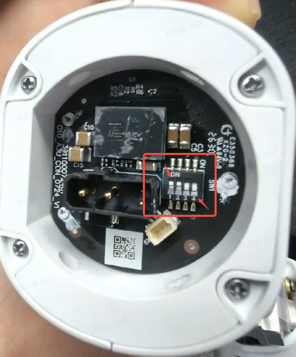

# 快速入门指南

[English](../en/QUICK_START.md)

本指南帮助您在 5 分钟内开始使用 OmniHand SDK。

## 步骤 1：硬件连接

### 支持产品

| 产品 | 电源 | ZLG | HCAN | SocketCAN（Linux） | RS485 串口 | USB 直连 | 拨码开关 |
|---------|--------------|---------------------------|------|-------------------|--------------|------------|---------------------------|
| OmniHand 2025 (O10) | 24V | ✅ | ✅ | ✅ | ✅ | ✅ | ❌ |
| OmniHand 3 (O10) | 24V | ✅ | ✅ | ✅ | ✅ | ❌ | ✅ |
| OmniHand Pro 2025 (O12) | 24V | ✅ | ✅ | ✅ | ❌ | ❌ | ❌ |
| OmniHand 3 Lite (H3L) | 24V | ✅ | ✅ | ✅ | ✅ | ❌ | ✅ |
| OmniHand 3 Ultra M (H3UM) | 48V | ✅ | ✅ | ✅ | ❌ | ❌ | ❌ |
| OmniHandPicker 2025 (OP1) | 24V | ✅ | ✅ | ✅ | ❌ | ✅ | ❌ |
| OmniPicker 3 (OP3) | 24V | ✅ | ✅ | ✅ | ✅ | ❌ | ✅ |

“拨码开关”列表示产品机身是否配有用于选择 CANFD 或 RS485 的开关，具体拨码位置见下方接线步骤。

### CANFD 适配器与配置

| 连接方式 | 支持型号 | 配置说明 |
|----------|----------|----------|
| ZLG USBCANFD（推荐） | 100U-mini、100U、200U | — |
| HCAN | CANFD-I、CANFD-II | — |
| SocketCAN（Linux） | 任何提供 SocketCAN 驱动的 CAN 卡 | [SocketCAN 配置指南](SOCKETCAN_SETUP.md) |

### 推荐：ZLG USBCANFD 适配器（所有产品）

1. 将电脑连接到 **CAN 盒（ZLG USBCANFD 适配器）的 USB 接口**。请使用上述推荐型号，其他 CAN 盒很可能无法直接使用。
2. 若产品带有 **接口选择拨码开关**（见上表），按照片中的方向设置：使用 **CANFD** 时，**1、2 向上，3、4 向下**；使用 **RS485** 时，**1、2 向下，3、4 向上**。

   

3. 用 CANFD 线缆连接 CAN 盒和 OmniHand，确认 **CAN_H 接 CAN_H、CAN_L 接 CAN_L**；两根线接反会导致通信无响应。
4. 按产品表中标注的电压给 OmniHand 上电；上电后，灵巧手的指示灯会亮起。

```
[电脑] --USB--> [ZLG USBCANFD] --CANFD--> [OmniHand]
                                      |
                                [对应产品电源]
```

### 备选 1：USB 直连（仅限 OmniHand 2025）

通过 USB 线直接连接 OmniHand 2025 到电脑。

> **注意**：OmniHand 2025 仍需通过 CANFD 接口供电（24V），USB 仅用于数据通信。

### 备选 2：RS485 串口（O10、H3L、OP3）

通过 RS485 串口线连接 OmniHand 到电脑。

> **注意**：RS485 仅用于数据通信，请按对应型号的接线要求另行供电。

## 步骤 2：安装 SDK

### 环境要求

| | Linux | Windows |
|---|-------|---------|
| **操作系统** | Ubuntu 22.04+ | Windows 10/11 |
| **Python** | 3.10+ | 3.10+ |
| **C++ 编译器** | gcc 11.4+ | MSVC 2019+ |
| **C++ 标准** | C++17+ | C++17+ |
| **CMake** | 3.22+ | 3.22+ |
| **ROS2**（可选） | Humble/Jazzy | ❌ 不支持 |

### Linux

```bash
cd linux/x64
./install.sh

# 配置 USB 权限（仅首次需要, canfd适配器、RS485 串口均需要）
sudo ./setup_udev.sh
# 然后注销并重新登录
```

### Windows

以管理员身份运行：
```cmd
cd windows\x64
install.bat
```

## 步骤 3：运行对应产品的测试

连接上电后，关闭其他 CAN 工具；测试包含运动，请留出活动空间。

### 选择对应产品

测试文件位于 SDK 发布包对应的平台目录（`linux/x64`、`linux/aarch64` 或 `windows/x64`）下：

| 内容 | 相对路径 |
|------|----------|
| Python 测试脚本 | `python/test/` |
| C++ 测试程序 | `cpp/bin/omnihand/test/` |
| C++ 测试源码 | `cpp/test/` |

在对应目录中选择产品的测试文件：

| 产品 | C++ 测试程序 | Python 测试文件 |
|------|-------------|-----------------|
| OmniHand 2025 & OmniHand 3 (O10) | `test_omnihand_2025` | `test_omnihand_2025.py` |
| OmniHand 3 Lite (H3L) | `test_omnihand_3_lite` | `test_omnihand_3_lite.py` |
| OmniPicker 3 (OP3) | `test_omnipicker_3` | `test_omnipicker_3.py` |
| OmniHand Pro 2025 (O12) | `test_omnihand_pro_2025` | `test_omnihand_pro_2025.py` |

下面以 **O10** 为例，展示不同连接方式的测试命令。请在上述平台目录下执行。

### C++（gtest）

直接使用发布包附带的测试程序。

**Linux：**

```bash
# ZLG CANFD
./cpp/bin/omnihand/test/test_omnihand_2025 -d zlgcan
# HCAN
./cpp/bin/omnihand/test/test_omnihand_2025 -d hcan
# Optional: O10 device ID change test
./cpp/bin/omnihand/test/test_omnihand_2025 -d zlgcan --device-id 5
# Connection options
./cpp/bin/omnihand/test/test_omnihand_2025 -h
```

**Windows（PowerShell；安装后重新打开终端，使 SDK 的 DLL 路径生效）：**

```powershell
# ZLG CANFD
.\cpp\bin\omnihand\test\test_omnihand_2025.exe -d zlgcan
# HCAN
.\cpp\bin\omnihand\test\test_omnihand_2025.exe -d hcan
# Optional: O10 device ID change test
.\cpp\bin\omnihand\test\test_omnihand_2025.exe -d zlgcan --device-id 5
# Connection options
.\cpp\bin\omnihand\test\test_omnihand_2025.exe --help
```

### Python（pytest）

使用安装 SDK 时的 Python 环境。O10 测试脚本内部调用 pytest，可直接通过命令行参数指定连接方式。

**Linux：**

```bash
python3 -m pip install pytest
python3 python/test/test_omnihand_2025.py -d zlgcan
```

**Windows（PowerShell）：**

```powershell
python -m pip install pytest
python .\python\test\test_omnihand_2025.py -d zlgcan
```

**O10 连接参数：**

| 参数 | 含义 |
|------|------|
| `-d` | 连接方式：`zlgcan`、`hcan`、`socketcan`、`zlgcantcp`、`usb` 或 `rs485` |
| `-p` | `usb` 或 `rs485` 使用的串口，填写设备实际分配的端口 |
| `-i` | CANFD 适配器索引，从 0 开始 |
| `-c` | CAN 通道索引，从 0 开始 |
| `--device-id` | O10 的 ID 修改测试目标值（1–127），清理时恢复原 ID；省略则只探测当前 ID |

按实际连接方式选择下面的命令：

**Linux：**

```bash
# HCAN
python3 python/test/test_omnihand_2025.py -d hcan
# RS485
python3 python/test/test_omnihand_2025.py -d rs485 -p /dev/ttyUSB0
# USB direct (OmniHand 2025)
python3 python/test/test_omnihand_2025.py -d usb -p /dev/ttyACM0
# Optional: O10 device ID change test
python3 python/test/test_omnihand_2025.py -d zlgcan --device-id 5
# pytest help
python3 python/test/test_omnihand_2025.py -h
```

**Windows（PowerShell）：**

```powershell
# HCAN
python .\python\test\test_omnihand_2025.py -d hcan
# RS485
python .\python\test\test_omnihand_2025.py -d rs485 -p COM5
# USB direct (OmniHand 2025)
python .\python\test\test_omnihand_2025.py -d usb -p COM3
# Optional: O10 device ID change test
python .\python\test\test_omnihand_2025.py -d zlgcan --device-id 5
# pytest help
python .\python\test\test_omnihand_2025.py --help
```

### 如何判断结果

- gtest 显示执行用例数量及 `[ PASSED ]`、`[ FAILED ]`、`[ SKIPPED ]` 结果。
- pytest 显示各用例结果，最后汇总 `passed / failed / skipped` 数量；`-s` 同时显示设备信息和反馈。
- 应确认初始化、设备信息及预期反馈用例通过。执行 0 个用例或全部跳过，均不能证明连接成功；验证完成前应检查失败和跳过的原因，参见[故障排除](TROUBLESHOOTING.md)。

## 步骤 4：第一个程序

### C++ 示例

以 O10 左手、ZLG 适配器 0、通道 0 为例：探测设备 ID、读取电机位置，再将当前位置作为目标下发。位置单位为电机编码值。

新建 `my_omnihand_app` 目录，在其中保存以下两个文件：

**CMakeLists.txt:**

```cmake
cmake_minimum_required(VERSION 3.22)
project(my_omnihand_app LANGUAGES CXX)

if(WIN32)
  list(APPEND CMAKE_MODULE_PATH "C:/omnihand/share/cmake/omnihand")
else()
  list(APPEND CMAKE_MODULE_PATH "/usr/local/share/cmake/omnihand")
endif()
find_package(omnihand REQUIRED)

add_executable(my_app main.cpp)
target_compile_features(my_app PRIVATE cxx_std_17)
target_link_libraries(my_app PRIVATE omnihand)
```

**main.cpp:**

```cpp
#include <iostream>
#include "omnihand/omnihand_2025.h"

using namespace agilink::omnihand;

int main() {
  // Default protocol IDs, adapter 0, channel 0.
  auto hand = OmniHand2025::createHandByZlgcan(HandType::LEFT, 0, 0, 0);
  if (!hand || !hand->Init()) {
    std::cerr << "Failed to initialize CAN adapter\n";
    return 1;
  }
  if (hand->GetHandDeviceIdByBroadcast() < 0) {
    std::cerr << "Device ID discovery failed\n";
    return 1;
  }

  const auto positions = hand->GetAllJointMotorPosi();
  if (positions.size() != OmniHand2025::kDegreesOfActiveFreedom) {
    std::cerr << "Failed to read motor positions\n";
    return 1;
  }
  std::cout << "Motor positions: ";
  for (const auto position : positions) {
    std::cout << position << ' ';
  }
  std::cout << '\n';

  // Hold the measured motor positions.
  const auto feedback = hand->SetAllJointMotorPosi(positions);
  if (feedback.size() != positions.size()) {
    std::cerr << "No valid control feedback\n";
    return 1;
  }
  std::cout << "Position command sent\n";
  return 0;
}
```

安装 SDK 后，在 `my_omnihand_app` 目录中编译并运行：

**Linux：**

```bash
cmake -S . -B build
cmake --build build
./build/my_app
```

**Windows（PowerShell，MSVC x64）：**

```powershell
cmake -S . -B build -A x64
cmake --build build --config Release
.\build\Release\my_app.exe
```

接口说明：[O10 C++ API](API_CPP_O10.md)。

### Python 示例

保存为 `my_app.py`，连接和控制流程与 C++ 示例一致。

```python
from omnihand import HandType, OmniHand2025

hand = OmniHand2025.create_hand_by_zlgcan(
    hand_type=HandType.LEFT,
    hand_device_id=0,  # Use protocol defaults before explicit discovery.
    canfd_device_id=0,
    canfd_channel_id=0,
)
if hand is None or not hand.init():
    raise SystemExit("Failed to initialize CAN adapter")
if hand.get_hand_device_id_by_broadcast() < 0:
    raise SystemExit("Device ID discovery failed")

positions = hand.get_all_joint_positions()
if len(positions) != OmniHand2025.kDegreesOfActiveFreedom:
    raise SystemExit("Failed to read motor positions")
print(f"Motor positions: {positions}")

# Hold the measured motor positions.
feedback = hand.set_all_joint_positions(positions)
if len(feedback) != len(positions):
    raise SystemExit("No valid control feedback")
print("Position command sent")
```

**Linux：**

```bash
python3 my_app.py
```

**Windows（PowerShell）：**

```powershell
python .\my_app.py
```

接口说明：[O10 Python API](API_PYTHON_O10.md)。

### ROS2 示例（仅限 Linux）

```bash
# 加载 ROS2 和 OmniHand 环境
source ros2/setup.bash

# 使用 launch 文件启动（推荐，默认单手左手）
ros2 launch omnihand_node omnihand_2025_node.launch.py

# 或使用 ros2 run（使用默认参数）
ros2 run omnihand_node omnihand_2025_node
```

**通过 ROS2 Topic 控制：**

```bash
# 设置关节位置（10 个值，使用 sensor_msgs/JointState）
ros2 topic pub /o10/left/joint_cmd sensor_msgs/msg/JointState \
  "{position: [0.0, 0.0, 0.0, 0.0, 0.0, 0.0, 0.0, 0.0, 0.0, 0.0]}"

# 读取关节状态
ros2 topic echo /o10/left/joint_states

# 请求电流数据（触发式回读）
ros2 topic pub /o10/left/joint_current_cmd std_msgs/msg/Empty "{}"
ros2 topic echo /o10/left/joint_current_states
```

> 详细 Topic 列表和各产品差异请参考 [ROS2 API 文档](API_ROS2.md)。

## 步骤 5：探索示例

以下路径相对于发布包的平台目录（`linux/x64`、`linux/aarch64` 或 `windows/x64`）。

### C++

| 产品 | 路径 |
|---------|------|
| OmniHand 2025 & OmniHand 3 (O10) | `cpp/demo/omnihand_2025/` |
| OmniHand Pro 2025 (O12) | `cpp/demo/omnihand_pro_2025/` |
| OmniHand 3 Lite (H3L) | `cpp/demo/omnihand_3_lite/` |
| OmniHand 3 Ultra M (H3UM) | `cpp/demo/omnihand_3_ultra_m/` |
| OmniHandPicker 2025 (OP1) | `cpp/demo/omnipicker_2025/` |
| OmniPicker 3 (OP3) | `cpp/demo/omnipicker_3/` |

### Python

| 产品 | 路径 |
|---------|------|
| OmniHand 2025 & OmniHand 3 (O10) | `python/demo/omnihand_2025/` |
| OmniHand Pro 2025 (O12) | `python/demo/omnihand_pro_2025/` |
| OmniHand 3 Lite (H3L) | `python/demo/omnihand_3_lite/` |

### ROS2（仅限 Linux）

`<distro>` 为与 ROS2 环境对应的 `humble` 或 `jazzy`。

| 类型 | 产品 | 路径 |
|------|---------|------|
| scripts | OmniHand 2025 & OmniHand 3 (O10) | `ros2/<distro>/lib/omnihand_node/scripts/omnihand_2025/` |
| scripts | OmniHand Pro 2025 (O12) | `ros2/<distro>/lib/omnihand_node/scripts/omnihand_pro_2025/` |
| scripts | OmniHand 3 Lite (H3L) | `ros2/<distro>/lib/omnihand_node/scripts/omnihand_3_lite/` |
| scripts | OmniHand 3 Ultra M (H3UM) | `ros2/<distro>/lib/omnihand_node/scripts/omnihand_3_ultra_m/` |
| scripts | OmniPicker 3 (OP3) | `ros2/<distro>/lib/omnihand_node/scripts/omnipicker_3/` |
| demo | 通用 C++ 示例 | `ros2/<distro>/share/omnihand_node/demo/` |

## 下一步

### API 清单

1. **OmniHand 2025 & OmniHand 3 (O10)**

   - [O10 C++ API](API_CPP_O10.md)
   - [O10 Python API](API_PYTHON_O10.md)
   - [O10 ROS2 API](API_ROS2_O10.md)（ROS2 仅限 Linux）
   - [O10 运动学 C++ API](API_KINEMATICS_CPP_O10.md)（纯计算，与物理连接无关）
   - [O10 运动学 Python API](API_KINEMATICS_PYTHON_O10.md)（纯计算，与物理连接无关）

2. **OmniHand Pro 2025 (O12)**

   - [O12 C++ API](API_CPP_O12.md)
   - [O12 Python API](API_PYTHON_O12.md)
   - [O12 ROS2 API](API_ROS2_O12.md)（ROS2 仅限 Linux）
   - [O12 运动学 C++ API](API_KINEMATICS_CPP_O12.md)（纯计算，与物理连接无关）
   - [O12 运动学 Python API](API_KINEMATICS_PYTHON_O12.md)（纯计算，与物理连接无关）

3. **OmniHand 3 Lite (H3L)**

   - [H3L C++ API](API_CPP_H3L.md)
   - [H3L Python API](API_PYTHON_H3L.md)
   - [H3L ROS2 API](API_ROS2_H3L.md)（ROS2 仅限 Linux）
   - [H3L 运动学 C++ API](API_CPP_H3L.md#运动学求解器)（纯计算，与物理连接无关）
   - [H3L 运动学 Python API](API_PYTHON_H3L.md#主动关节角与离线求解器)（纯计算，与物理连接无关）

4. **OmniHand 3 Ultra M (H3UM)**

   - [H3UM C++ API](API_CPP_H3UM.md)
   - [H3UM Python API](API_PYTHON_H3UM.md)
   - [H3UM ROS2 API](API_ROS2_H3UM.md)（ROS2 仅限 Linux）
   - [H3UM 运动学 C++ API](API_CPP_H3UM.md#运动学求解器)（纯计算，与物理连接无关）
   - [H3UM 运动学 Python API](API_PYTHON_H3UM.md#运动学求解器)（纯计算，与物理连接无关）

5. **OmniHandPicker 2025 (OP1)**

   - [OP1 C++ API](API_CPP_OP1.md)

6. **OmniPicker 3 (OP3)**

   - [OP3 C++ API](API_CPP_OP3.md)
   - [OP3 Python API](API_PYTHON_OP3.md)
   - [OP3 ROS2 API](API_ROS2_OP3.md)（ROS2 仅限 Linux）

**[故障排除](TROUBLESHOOTING.md)** - 常见问题和解决方案
